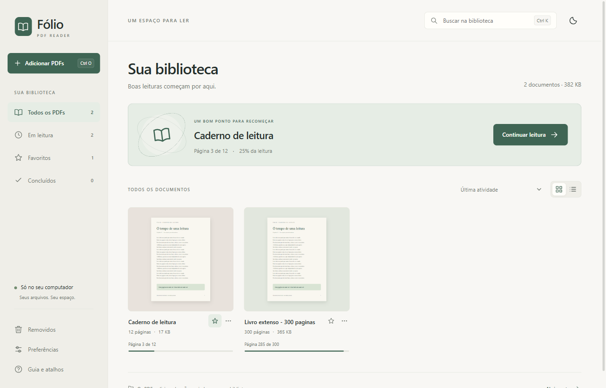

# Fólio

[](https://github.com/MakenRosa/folio/actions/workflows/ci.yml)

Leitor de PDF para Windows com biblioteca local, retomada de leitura e controles
de conforto. Feito com Tauri 2, Rust, TypeScript e PDF.js, sem conta ou servidor.

O projeto nasceu de uma necessidade cotidiana: guardar uma cópia dos livros,
continuar de onde a leitura parou e reduzir o brilho sem inverter o papel.
O modo Kindle acrescenta avanço por telas no zoom atual, inclusive quando uma
tela atravessa a divisão entre duas páginas do PDF.



[Demonstração](docs/demo.md) · [Arquitetura](docs/architecture.md) ·
[Resultados dos testes](VALIDATION.md) · [Como contribuir](CONTRIBUTING.md)

## O que está implementado

- Importação de um ou vários PDFs, por diálogo ou arrastar e soltar. Cada arquivo
  é copiado para a biblioteca; SHA-256 evita duplicatas de conteúdo.
- Busca na biblioteca, grade/lista, ordenação, favoritos, concluídos, renomeação,
  exportação de cópia e restauração de documentos removidos.
- Busca textual no PDF, seleção, sumário, zoom, rotação, marcadores, notas,
  foco e tela cheia.
- Retomada opcional de página, posição e zoom por documento.
- Interface clara/escura/sistema, papel claro/sépia/escuro, tela quente e brilho
  da leitura de 10% a 100%, combináveis e salvos automaticamente.
- Modo Kindle com avanço instantâneo por telas e pequena sobreposição para
  preservar linhas cortadas. Aceita teclado e roda do mouse.

O layout original do PDF é preservado, incluindo margens e imagens. Não há
refluxo de texto, OCR, edição de páginas, assinatura digital ou preenchimento
de formulários. O papel escuro inverte também as imagens. Notas e marcadores
ficam no catálogo, sem alterar o PDF. Senhas de PDFs não são armazenadas.

## Executar a partir do código

Ambiente validado: Windows x64, Node.js 24, Rust com toolchain MSVC,
Microsoft C++ Build Tools e WebView2. O runtime WebView2 precisa estar instalado.
Outros sistemas não foram validados.

```powershell
git clone https://github.com/MakenRosa/folio.git
cd folio
npm ci
npm run tauri -- dev
```

`npm run dev` sozinho inicia apenas o frontend. A biblioteca e os comandos de
arquivos precisam da janela Tauri. As fontes, mapas e codecs de PDF.js são
preparados automaticamente; o uso normal do aplicativo não depende de rede.

Para compilar:

```powershell
npm run tauri -- build
```

O instalador NSIS fica em `src-tauri/target/release/bundle/nsis/`. Não há
instalador público assinado nesta preparação. Para instalações antigas de
Lume PDF, leia [compatibilidade](docs/compatibility.md) antes de distribuir uma
atualização com o nome novo.

## Verificar

Python 3.12 ou posterior é usado para gerar documentos artificiais e empacotar
o código. Não faz parte do aplicativo instalado.

```powershell
python -m pip install -r requirements-test.txt
npm run build
npm run check
npm run test:native
npm run package:source
```

Se Python não estiver no PATH, defina `FOLIO_PYTHON` com o caminho do executável.
A suíte nativa cria sua própria identidade, biblioteca e perfil WebView2 dentro
de `test-results/native/`. Ela valida o destino antes de importar documentos e
encerra somente o processo que iniciou. Não use uma biblioteca pessoal como
fixture de teste. Evidências locais ficam em `test-results/` e não entram no ZIP.

O [workflow de Windows](https://github.com/MakenRosa/folio/actions/workflows/ci.yml)
é executado em pushes para `main` e pull requests. Os resultados documentados
em `VALIDATION.md` são da execução local; o histórico remoto está no GitHub Actions.

## Dados e decisões técnicas

As instalações existentes usam `%LOCALAPPDATA%\com.lume.pdf`. `pdfs/` guarda as
cópias, `covers/` as capas e `library.json` o catálogo com progresso e notas.
`library.backup.json` permite recuperar o catálogo anterior. As preferências
ficam no perfil WebView2. Para backup, feche o aplicativo e copie a pasta inteira.

Rust faz a cópia em blocos e a persistência do catálogo. PDF.js é carregado sob
demanda; o transporte lê faixas da cópia local e a renderização limita canvases
ativos e resolução. O modo Kindle desloca a área visível, sem construir uma
imagem gigante do documento. Veja as escolhas, custos e limites em
[arquitetura](docs/architecture.md).

O Fólio demonstra integração desktop, persistência local, interface e testes.
Não inclui backend web, autenticação ou serviços distribuídos. Foi desenvolvido
com assistência de IA e refinado a partir do uso e de testes locais.

## Licença

Código original sob [MIT](LICENSE). Dependências mantêm suas próprias licenças;
consulte [THIRD_PARTY.md](THIRD_PARTY.md). Os PDFs das demonstrações são artificiais.
O projeto não tem vínculo com a Amazon.
