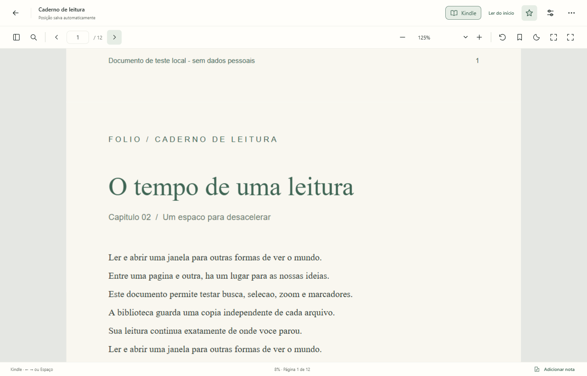
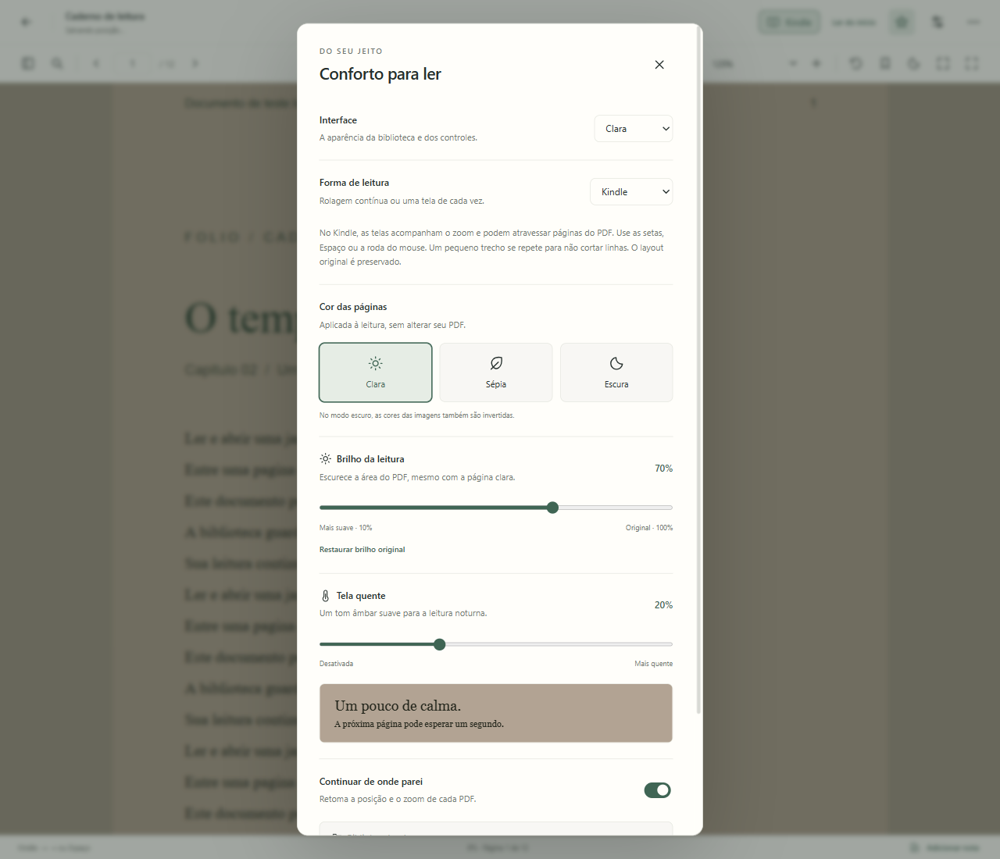

# Demonstração

Capturas da janela nativa do Fólio, com PDFs gerados pelos scripts de teste.
Nenhum documento pessoal aparece nas imagens.

## Biblioteca e retomada

A biblioteca mantém cópias dos arquivos e oferece acesso direto à leitura recente.


## Uma tela de cada vez

O controle Kindle avança pelo documento no zoom atual. Uma tela pode mostrar
trechos de duas páginas, mantendo a diagramação do PDF.



## Conforto sem inverter o papel

Brilho e tela quente podem ser combinados com papel claro. Os controles estão no
botão Aparência da barra de leitura e nas preferências, sem ocupar permanentemente a
área de leitura.



Para reproduzir as capturas junto com os testes:

```powershell
npm run test:native -- --demo
```

As imagens são salvas em `docs/media/`. O caminho da biblioteca de testes fica
oculto na captura das preferências para não expor o nome da conta do computador.
